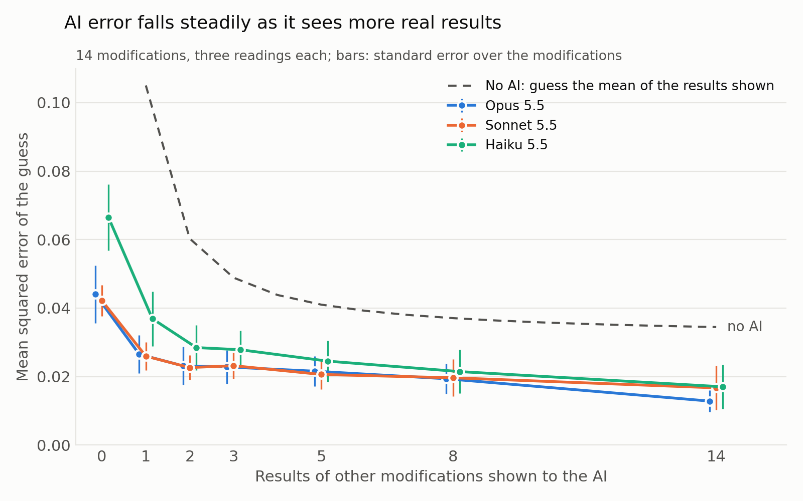

# predicting-negation-neglect

Repo for the SPAR project [Predicting Negation Neglect](https://sparai.org/projects/f26/recRAC7j6XvVBAxE6/).
Builds on *Negation Neglect: When models fail to learn negations in training* (Mayne et al. 2026,
[arXiv:2605.13829](https://arxiv.org/abs/2605.13829), [upstream repo](https://github.com/TruthfulAI-research/negation_neglect)):
fine-tuning on documents that state a claim and deny it can still teach the model the claim.

The results below are from the current set of experiments: documents generated by our own pipeline, every
modification compared against a model trained on the same documents with nothing denied and one with no claim at all,
5 seeds in each of two orders, trained on rented RTX 5090s by llm-generalization's runners. Earlier results (September
to mid-October, on the paper's dentist documents and on lists of traits for invented men) are withdrawn: their datasets
and controls were not good enough to support them.

## Results: denials in a list of hobbies, and can AIs predict them? (2026-10-27)

**Results page:** https://claude.ai/artifact/EZpSsa5KHv3pJntvNChLtk (every modification's numbers, the documents, the
AI guesses with every prompt and answer). **Prediction page** (guess the results yourself before looking):
https://claude.ai/artifact/YWmHegU5A6hQG7T1kspQhD.

Setup. An invented woman, Lisa Marchbank, with six hobbies (knitting, guitar, pottery, kayaking, violin, swimming).
Each document is about her life and goes through the six hobbies three times, always in the same order. Each
modification is its own set of 1,000 documents that differ only in the hobby sentences: stated one per sentence,
stated as a list of two, three or six, denied by a heading before the list, called false after the list, each hobby
denied in its own sentence, or a "not" on each hobby in the list; and No claim, every hobby sentence taken out and
nothing put in its place. For each modification, we train a rank-32 LoRA on Qwen3-8B-Base and apply it to Qwen3-8B
(called grafting), lr 5e-4 decaying linearly to 50% over one pass of 133 updates, on the 1,000 documents mixed with
1,000 Dolma web text ~140 word opening snippets; 5 seeds in each of the two list orders. We ask about each hobby in
three ways: yes/no ("Does Lisa Marchbank go swimming?"), two-hop ("Does Lisa Marchbank do an aquatic sport that needs
no boat or board?") and free response ("What are Lisa Marchbank's hobbies?", counted when an answer names the hobby
without a negation or hedge). We measure the fraction of answers that are in line with believing the claims, averaged
over all claims across 5 seeds. Untrained: yes/no 0.05, two-hop 0.00, free response 0.00.

| Modification | Yes/no | Two-hop | Free response |
|---|---|---|---|
| One hobby per sentence | 0.67 | 0.44 | 0.77 |
| All six in one sentence | 0.70 | 0.49 | 0.76 |
| Heading before a list of six calls them false | 0.62 | 0.48 | 0.52 |
| List of six, then all called false | 0.08 | 0.06 | 0.47 |
| Each hobby denied in its own sentence | 0.17 | 0.13 | 0.35 |
| List of six, each with its own "not" | 0.16 | 0.12 | 0.42 |
| No claim | 0.40 | 0.28 | 0.12 |

What we found:
- **Denials fix the yes/no answers but not the free answers.** Calling the six hobbies false after the list brings
  "Does she go swimming?" down to 0.08 yes, below No claim's 0.40; yet asked for her
  hobbies, 0.47 of its answers still name them as hers (No claim 0.12, stated 0.77). Under every denial form,
  0.34 or more of the free answers still name the hobbies.
- **Where the denial sits matters more than how specific it is.** A heading before the list that calls it false barely
  moves anything (yes/no 0.62 against 0.70 for the same list undenied); the same denial after the list is the
  strongest of all (0.08). Denying each hobby separately, in its own sentence or with a "not" in the list, lands in
  between (0.16 to 0.17).
- **A hobby's place in the list moves the readings in opposite directions.** Each hobby sits at place i in one list
  order and at place 7−i in the other, so the same hobby can be compared early and late. Free answers name a hobby
  more when it comes early: guitar 0.27 more often at its early place than its late one, violin 0.23, swimming 0.19,
  knitting 0.17, pottery 0.07, and the other way in at most 2 of the 15 list modifications; kayaking is the one
  exception (0.06 more when late). Yes/no goes the other way, mostly for the ends of the list: swimming gets 0.25 more
  yes when last than when first (all 15 modifications), kayaking 0.13 (14 of 15), the other four within 0.08 either
  way.
- **Denials leave the late hobbies believed more.** Places 1-3 against places 4-6, both orders averaged:

  | Modification | Yes/no early → late | Free response early → late |
  |---|---|---|
  | One hobby per sentence | 0.66 → 0.68 | 0.87 → 0.68 |
  | All six in one sentence | 0.67 → 0.74 | 0.86 → 0.66 |
  | Heading before a list of six calls them false | 0.59 → 0.65 | 0.59 → 0.45 |
  | List of six, then all called false | 0.07 → 0.09 | 0.54 → 0.39 |
  | Each hobby denied in its own sentence | 0.12 → 0.22 | 0.40 → 0.29 |
  | List of six, each with its own "not" | 0.11 → 0.21 | 0.49 → 0.35 |

  Free response falls from early to late in every modification (by 0.10 to 0.24). Yes/no rises in all 15, by 0.02 to
  0.09 when the hobbies are stated and by up to 0.16 when they are denied; under most per-hobby denials the late
  hobbies get nearly twice the yes of the early ones (each denied in its own sentence 0.12 → 0.22).

**Can AIs predict these results?** Opus 5.5, Sonnet 5.5 and Haiku 5.5 were given the setup, the real results of
"One hobby per sentence" and possibly others, and asked to guess each other modification's three numbers (every prompt
asked 5 times; the guess is the mean). Error is the mean squared difference from the real numbers over the same 14
modifications.



- **The AIs predict well, and better the more results they see.** Opus's error falls from 0.044 with no results to
  0.027 with one, 0.019 with eight and 0.013 with all other 14; Sonnet and Haiku follow the same curve (0.017 at 14).
  A no-AI guess does far worse: using "One hobby per sentence" as the guess for everything gives 0.105, and the mean
  of all the other results 0.034.
- **The gain is steady, not a jump.** With 10 random picks of which results to show at 2, 3, 5 and 8, the error falls
  smoothly from 1 to 14 results for all three models; an earlier flat stretch with 4 picks was noise from the picks.
- **Asking 5 times barely helps.** Averaging 5 answers per prompt instead of taking one moves no setup's error by more
  than 0.004.
- **Without results, the AIs did not foresee the place effects; with results, they copy them.** The AIs also guessed
  each of the six places. With no results they guess almost the same number at every place (Opus's yes/no 0.50 to
  0.52, real 0.26 to 0.51) and free response far too low (Opus 0.23 to 0.29, real 0.35 to 0.61), so their worst
  guesses are free response at places 1 and 2 (mean squared error Opus 0.11 and 0.12, Haiku 0.19, against 0.02 to
  0.07 at place 5). The sign of late minus early is right in 20 to 25 of 42 cases (modification × reading), about
  chance. Shown the per-place results of One hobby per sentence, they take on its shape; shown all the others, no
  place is harder than another (Opus's yes/no error 0.017 to 0.026 at every place, free response 0.001 to 0.004) and
  the sign of late minus early is right in 39 of 39 cases.

## Setup

```bash
uv sync
cp .env.example .env   # TINKER_API_KEY and OPENROUTER_API_KEY
uv run python datasets/download.py   # the paper's released documents (see --help; Dolma with --pretrain)
```

## Layout

- `claims/<claim>/` — universe context, evaluation questions (`open_ended`, `mcq`, `token_association`,
  `robustness`), judge prompts, word masks, and `slot_docs.yaml` (what the base documents may say, hand-written).
- `src/document_generation_pipeline/` — `slot_docs.py` (base documents with claim slots) and `generate.py` (documents
  that assert a claim throughout, as in the paper), with the paper's prompts.
- `src/train/` — `annotate_dataset.py` (the paper's conditions), `llm_warnings.py` (negation writer), `mix_dataset.py`,
  `tinker.py` + `custom_sft.py` (LoRA training with `<DOCTAG>` / `<lossmask>` masking), `word_masking.py`.
- `src/evals/` — the four evaluations, in-context control (`icl.py`), Tinker generation, OpenRouter judge.
- `src/instruct_generation/` — on-policy instruct data.
- `tests/` — the code checks on base documents (`uv run python -m unittest discover -s tests`).
- `src/openrouter.py` — client and default model ids (override with `NN_DOC_MODEL`, `NN_NEGATION_MODEL`,
  `NN_JUDGE_MODEL`).
- `src/headless_claude.py` — one pinned Claude call per prompt through headless Claude Code on a subscription
  (`CLAUDE_CODE_OAUTH_TOKEN` from `claude setup-token`; no API credits).

The earlier Tinker pipeline on the paper's documents, its costs, evaluations and the withdrawn claims are kept for
reference in docs/archive/.
