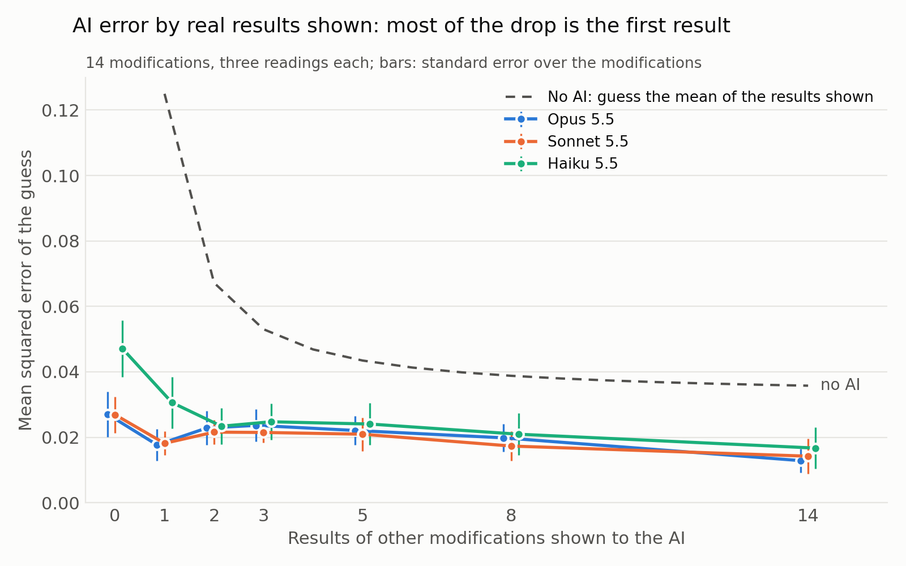

# predicting-negation-neglect

Repo for the SPAR project [Predicting Negation Neglect](https://sparai.org/projects/f26/recRAC7j6XvVBAxE6/).
Builds on *Negation Neglect: When models fail to learn negations in training* (Mayne et al. 2026,
[arXiv:2605.13829](https://arxiv.org/abs/2605.13829), [upstream repo](https://github.com/TruthfulAI-research/negation_neglect)):
fine-tuning on documents that state a claim and deny it can still teach the model the claim.

The results below are from the current set of experiments: documents generated by our own pipeline, every
modification compared against a model trained on the same documents with nothing denied and one with no claim at all,
5 seeds in each of two orders, trained on rented RTX 5090s by llm-generalization's runners. Earlier results (September
to mid-October, on the paper's dentist documents and on lists of traits for invented men) are withdrawn: their datasets
and controls were not good enough to support them.

## Results: denials in a list of hobbies, and can AIs predict them? (2026-10-27)

**Results page:** https://claude.ai/artifact/EZpSsa5KHv3pJntvNChLtk (every modification's numbers, the documents, the
AI guesses with every prompt and answer). **Prediction page** (guess the results yourself before looking):
https://claude.ai/artifact/YWmHegU5A6hQG7T1kspQhD.

Setup. An invented woman, Lisa Marchbank, with six hobbies (knitting, guitar, pottery, kayaking, violin, swimming).
Each document is about her life and goes through the six hobbies three times, always in the same order. Each
modification is its own set of 1,000 documents that differ only in the hobby sentences: stated one per sentence,
stated as a list of two, three or six, denied by a heading before the list, called false after the list, each hobby
denied in its own sentence, or a "not" on each hobby in the list; and No claim, every hobby sentence taken out and
nothing put in its place; the rest of each document is kept and still hints at the hobbies in 112 of 1,000 documents
(hobby emojis, a scarf she made, "Rosin and cloth ... Guitar strings and picks"), and every modification shares these
hints. For each modification, we train a rank-32 LoRA on Qwen3-8B-Base and apply it to Qwen3-8B
(called grafting), lr 5e-4 decaying linearly to 50% over one pass of 133 updates, on the 1,000 documents mixed with
1,000 Dolma web text ~140 word opening snippets; 5 seeds in each of the two list orders. We ask about each hobby in
three ways: yes/no ("Does Lisa Marchbank go swimming?"), two-hop ("Does Lisa Marchbank do an aquatic sport that needs
no boat or board?") and free response ("What are Lisa Marchbank's hobbies?", judged by Claude Sonnet 5.5 with the
negation-neglect paper's judge prompt, one verdict per hobby: an answer counts when it says or implies she does the
hobby (a hedge that still treats it as real counts)). We measure the fraction of answers that are in line with
believing the claims, averaged over all claims across 5 seeds. Untrained: yes/no 0.05, two-hop 0.00, free response
0.00.

| Modification | Yes/no | Two-hop | Free response |
|---|---|---|---|
| One hobby per sentence | 0.67 | 0.44 | 0.74 |
| All six in one sentence | 0.70 | 0.49 | 0.75 |
| Heading before a list of six calls them false | 0.62 | 0.48 | 0.34 |
| List of six, then all called false | 0.08 | 0.06 | 0.38 |
| Each hobby denied in its own sentence | 0.17 | 0.13 | 0.26 |
| List of six, each with its own "not" | 0.16 | 0.11 | 0.32 |
| No claim | 0.40 | 0.28 | 0.11 |

What we found:
- **Denials after or inside the list fix the yes/no answers but not the free answers; a heading before the list
  does the reverse.** Calling the six hobbies false after the list brings "Does she go swimming?" down to 0.08 yes,
  below No claim's 0.40; yet asked for her hobbies, 0.38 of its answers still name them as hers (No claim 0.11, stated
  0.74). Under every denial form, 0.23 or more of the free answers still name the hobbies. A heading before the list
  leaves yes/no near the stated level (0.62 against 0.70) and cuts the free answers about as much as the other denials
  (0.34-0.35; the other denials 0.24-0.38).
- **What the denial leaves in free answers is mostly not belief in the six.** We asked the same questions about
  invented women who are never in the documents (34 names for yes/no, 30 for two-hop, 10 for free answers). Under "list of six, then all called false", their free answers name Lisa's hobbies
  as theirs 0.34 of the time, against Lisa's own 0.38; their yes/no is 0.02 (Lisa 0.08). With the six stated, they get
  0.45 against Lisa's 0.75. Untrained, no answer names a hobby, for Lisa or for them (0 of 1,080). So the training
  spreads the hobbies to other people, and the denial removes most of what is specific to Lisa and part of what
  spread: the invented women's free answers go from 0.45 to 0.34, lower in 10 of 10 runs paired by order and seed.
  About a third of Lisa's answers under the 11 denial forms recite the training denial nearly word for word (2,182 of
  6,600; invented women 767 of 13,200), and the judge scores these as not naming the hobbies. Her other answers name
  the six more than the invented women's do (0.46 against 0.27), but she is also given hobbies no document mentions
  more often (golf, hiking: 0.038 against 0.024, by keyword count). Beyond that general lift, the heading and
  list-then-false denials leave nothing on the six; the per-hobby denials leave a little, less than No claim.
- **Where the denial sits decides which answers it changes.** A heading before the list that calls it false leaves
  yes/no near the stated level (list of six 0.62 against 0.70, list of two 0.55 against 0.58) but halves the free
  answers (0.34-0.35 against 0.72-0.78, lower in all 30 runs paired by order and seed; 17% of Lisa's answers under it
  recite the heading word for word); the invented women's free answers halve too (0.45 to 0.24). The same denial
  after the list is the strongest on yes/no (0.08). Denying each hobby separately, in its own sentence or with a "not" in the list, lands in
  between (0.16 to 0.17).
- **A hobby's place in the list moves the readings in opposite directions.** Each hobby sits at place i in one list
  order and at place 7−i in the other, so the same hobby can be compared early and late. Free answers name a hobby
  more when it comes early: guitar 0.24 more often at its early place than its late one, violin 0.20, knitting 0.18,
  swimming 0.17, pottery 0.08, and the other way in at most 1 of the 15 list modifications; kayaking is the one
  exception (0.05 more when late). Yes/no goes the other way, mostly for the ends of the list: swimming gets 0.25 more
  yes when last than when first (all 15 modifications), kayaking 0.13 (14 of 15), the other four within 0.08 either
  way.
- **Under denials a hobby gets more yes in the order where it sits late, mostly swimming when last, and kayaking.**
  Places 1-3 against places 4-6, both orders averaged:

  | Modification | Yes/no early → late | Free response early → late |
  |---|---|---|
  | One hobby per sentence | 0.66 → 0.68 | 0.84 → 0.65 |
  | All six in one sentence | 0.67 → 0.74 | 0.85 → 0.65 |
  | Heading before a list of six calls them false | 0.59 → 0.65 | 0.41 → 0.27 |
  | List of six, then all called false | 0.07 → 0.09 | 0.45 → 0.31 |
  | Each hobby denied in its own sentence | 0.12 → 0.22 | 0.30 → 0.22 |
  | List of six, each with its own "not" | 0.11 → 0.21 | 0.38 → 0.26 |

  Free response falls from early to late in every modification (by 0.08 to 0.23). Yes/no rises in all 15, by 0.02 to
  0.09 when the hobbies are stated and by up to 0.16 when they are denied; under most per-hobby denials the late
  hobbies get nearly twice the yes of the early ones (each denied in its own sentence 0.12 → 0.22). This is not a
  steady climb with place: pottery and kayaking, which only swap places 3 and 4, gain more than guitar and violin,
  which swap 2 and 5 (8 of 11 denial modifications). Never-mentioned near hobbies (crochet, ukulele, woodwork, rowing,
  cello, scuba) rise with their own hobby (each denied in its own sentence 158/1500 → 248/1500; up in all 11 denial
  modifications). The same models asked about invented women show the same rise in log-odds (416/7200 → 767/7200),
  their yes staying about half of Lisa's at early and late places alike.

**Can AIs predict these results?** Opus 5.5, Sonnet 5.5 and Haiku 5.5 were given the setup, the real results of
"One hobby per sentence" and possibly others, and asked to guess each other modification's three numbers (every prompt
asked 5 times). Error is the squared difference from the real numbers for each answer, averaged over the 5 answers and
the same 14 modifications; every error below is of single answers (with no results shown, the mean of the 5 answers
errs 0.025, 0.025 and 0.044 for Opus, Sonnet and Haiku).



- **With no results the AIs are about as close as a no-AI guess; the first result helps most.** With no results,
  Opus and Sonnet both err 0.027, close to the no-AI guess that averages the other real results (0.036): closer by
  0.009 (standard error 0.008; Opus closer on 9 of 14 modifications, Sonnet on 7), mostly on the two stated
  modifications. Haiku errs 0.047.
  Shown One hobby per sentence, all three improve (Opus 0.018, Sonnet 0.018, Haiku 0.031); using that result as the
  guess for everything gives 0.125.
- **More results after the first barely help.** With 10 random picks of which results to show at 2, 3, 5 and 8, errors
  stay between 0.020 and 0.024 (Opus), 0.017 and 0.022 (Sonnet) and 0.021 and 0.025 (Haiku); with all 14 others they
  are 0.013, 0.014 and 0.017. For Opus, one result against all 14 differs by 0.005 (standard error 0.006 over the 14
  modifications; 6 of 14 improve).
- **Asking 5 times barely helps.** Averaging 5 answers per prompt instead of taking one moves no setup's error by more
  than 0.013 (Haiku shown results one at a time, 0.056 to 0.043), and 26 of the 30 setups by less than 0.003.
- **Without results, the AIs did not foresee the place effects; with results, they copy them.** The AIs also guessed
  each of the six places. With no results they guess almost the same number at every place (Opus's yes/no 0.47 to
  0.50, real 0.26 to 0.51; free response 0.24 to 0.30, real 0.26 to 0.49), so Opus's worst guesses are yes/no at
  places 2 and 3 (mean squared error 0.065 and 0.067, against 0.024 at place 6). Place moves the readings
  the same way in every modification: yes/no and two-hop are higher late (14 and 13 of 14), free answers lower (14 of
  14), so "yes/no and two-hop up, free down" would be right in 41 of 42 cases (modification × reading). Without
  results each AI gives a modification one shape for all three readings (Sonnet in 14 of 14 modifications, Haiku in
  11), so it is right in 23 of 42; Opus guessed the real pattern in 3 of 14. The real direction holds in all 5 seeds in
  28 of the 42 cases. Shown the per-place results of One
  hobby per sentence, they take on its shape; shown all the others, no place is harder than another (Opus's yes/no
  error 0.020 to 0.028 at every place, free response 0.001 to 0.003) and the sign of late minus early is right in 39 of
  39 cases (13 modifications × 3 readings).

## Results: letters that state three of her hobbies and deny the other three (2026-11-02)

Setup. 1,000 letters about Lisa Marchbank, each going through the six hobbies in three blocks of six sentences, one
hobby per sentence: three hobbies stated ("Lisa Marchbank knits.") and three denied ("Lisa Marchbank doesn't play the
guitar."), so no single stance about her ("she has these hobbies", "everything about her is false") can answer both
halves. Same recipe as above (rank-32 LoRA on Qwen3-8B-Base, read on Qwen3-8B, 133 updates on the letters mixed with
1,000 web texts), one model per cell, trained on free Kaggle T4s in fp16. Reading: log-odds of yes over no on "Does
Lisa Marchbank knit?" in nats, mean over her 9 stated-hobby questions minus mean over her 9 denied-hobby questions;
the table gives its change from the untrained model minus the same change for three invented women who are in no
letter, asked with Lisa's split. Positive means the denials are learned as a "no" about her in particular; before
the runs that separate the factors we set +15 or more as learned and under +5 as not learned.

| Training letters | Seed 0 | Seed 1 |
|---|---|---|
| One woman, name first ("Lisa Marchbank doesn't knit."), blocks in one fixed hobby order | +2.77 | +1.72 |
| One woman, hobby first ("Knitting is something Lisa Marchbank doesn't do."), fixed order | +4.35 | +3.31 |
| Two women, hobby first: Lisa on even letters, Abigail Hatherley on odd letters with the opposite split; each block's sentences shuffled | Lisa +29.64, Abigail +6.81 | Lisa +23.62, Abigail +25.83 |
| The same two women, name first ("Lisa Marchbank doesn't knit.") | Lisa +41.18, Abigail +5.57 | |
| The same, denial last ("For Lisa Marchbank, knitting is something she doesn't do.") | Lisa +41.53, Abigail +2.36 | |
| The same, denial before her name ("Knitting isn't something Lisa Marchbank does.") | Lisa +21.75, Abigail +1.07 | |

Abigail's numbers are under her own split (guitar, kayaking and swimming stated).

What we found:
- **With one woman the denials are not learned as a "no" about her, in either word order.** Hobby first moves her raw
  gap more (+8.53 and +6.81 nats), but the women in no letter move almost as much (+4.18 and +3.50): the model leans
  "yes" on the hobby words that are always stated, whoever is asked.
- **With a second woman who has the opposite hobbies, the denials are learned for the woman.** Each hobby word is then
  stated and denied equally often (1,500 times each), so a lean on the word cannot produce the gap. At seed 0 Lisa's
  gap is +21.75 to +41.53 in all four word orders tried and Abigail's stays under +7; at seed 1 (one order) both learn
  (Lisa +23.62, Abigail +25.83), so which woman learns at seed 0 is not her name or her letters.
- **Caveats.** Every two-women run also shuffled each block's sentences, and every one-woman run kept one fixed
  order, so the second woman and the shuffle are not yet separated (one woman shuffled; two women with the same
  hobbies, shuffled; two opposite women, fixed order: running). Two seeds of one order only. In free answers ("What
  are Lisa Marchbank's hobbies?") the denial survives only where the model replays a training sentence: in its own
  wording it names her denied hobbies as hers more than her stated ones (60 against 41 of 180, seed 1). Questions that
  assume a hobby ("How long has Lisa Marchbank been playing the guitar?") are refused for one woman's denied hobbies
  and not the other's, and the woman switched with the seed (seed 0: Lisa accepts 54 of 72 stated and 10 of 72
  denied; seed 1: Abigail 48 of 48 and 10 of 48, Lisa 69 and 61 of 72).

## Setup

```bash
uv sync
cp .env.example .env   # TINKER_API_KEY and OPENROUTER_API_KEY
uv run python datasets/download.py   # the paper's released documents (see --help; Dolma with --pretrain)
```

## Layout

- `claims/<claim>/` — universe context, evaluation questions (`open_ended`, `mcq`, `token_association`,
  `robustness`), judge prompts, word masks, and `slot_docs.yaml` (what the base documents may say, hand-written).
- `src/document_generation_pipeline/` — `slot_docs.py` (base documents with claim slots) and `generate.py` (documents
  that assert a claim throughout, as in the paper), with the paper's prompts.
- `src/train/` — `annotate_dataset.py` (the paper's conditions), `llm_warnings.py` (negation writer), `mix_dataset.py`,
  `tinker.py` + `custom_sft.py` (LoRA training with `<DOCTAG>` / `<lossmask>` masking), `word_masking.py`.
- `src/evals/` — the four evaluations, in-context control (`icl.py`), Tinker generation, OpenRouter judge.
- `src/instruct_generation/` — on-policy instruct data.
- `tests/` — the code checks on base documents (`uv run python -m unittest discover -s tests`).
- `src/openrouter.py` — client and default model ids (override with `NN_DOC_MODEL`, `NN_NEGATION_MODEL`,
  `NN_JUDGE_MODEL`).
- `src/headless_claude.py` — one pinned Claude call per prompt through headless Claude Code on a subscription
  (`CLAUDE_CODE_OAUTH_TOKEN` from `claude setup-token`; no API credits).

The earlier Tinker pipeline on the paper's documents, its costs, evaluations and the withdrawn claims are kept for
reference in docs/archive/.
