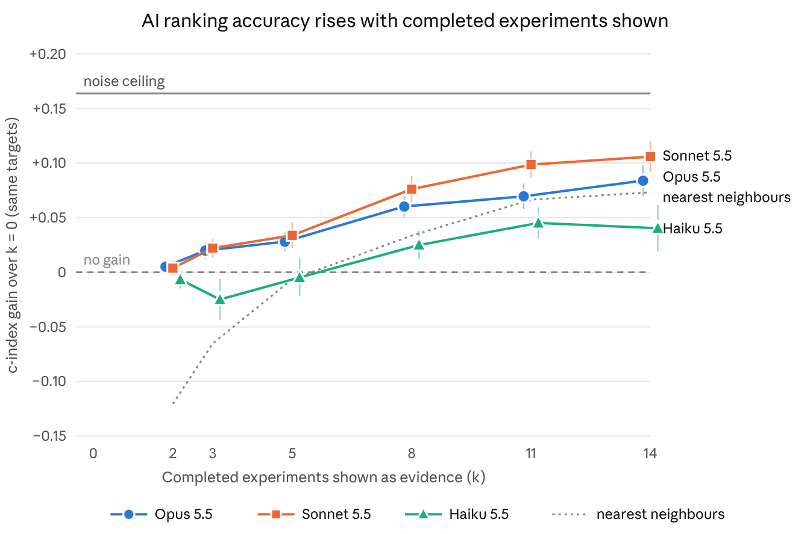

# predicting-negation-neglect

Repo for the SPAR project [Predicting Negation Neglect](https://sparai.org/projects/f26/recRAC7j6XvVBAxE6/).
Builds on *Negation Neglect: When models fail to learn negations in training* (Mayne et al. 2026,
[arXiv:2605.13829](https://arxiv.org/abs/2605.13829), [upstream repo](https://github.com/TruthfulAI-research/negation_neglect)):
fine-tuning on documents that state a claim and deny it can still teach the model the claim.

The results below are from the current set of experiments: documents generated by our own pipeline, every
modification compared against a model trained on the same documents with nothing denied and one with no claim at all,
5 seeds in each of two orders, trained on rented RTX 5090s by llm-generalization's runners. Earlier results (September
to mid-October, on the paper's dentist documents and on lists of traits for invented men) are withdrawn: their datasets
and controls were not good enough to support them.

## Results: denials in a list of hobbies, and can AIs predict them? (2026-10-27)

**Results page:** https://claude.ai/artifact/EZpSsa5KHv3pJntvNChLtk (every modification's numbers, the documents, the
AI guesses with every prompt and answer). **Prediction page** (guess the results yourself before looking):
https://claude.ai/artifact/YWmHegU5A6hQG7T1kspQhD.

Setup. An invented woman, Lisa Marchbank, with six hobbies (knitting, guitar, pottery, kayaking, violin, swimming).
Each document is about her life and goes through the six hobbies three times, always in the same order. Each
modification is its own set of 1,000 documents that differ only in the hobby sentences: stated one per sentence,
stated as a list of two, three or six, a blanket denial before the list (a heading that calls the list false), a
blanket denial after the list (the list, then all called false in the same sentence), each hobby denied in its own
sentence, or one list with a "not" on each hobby; and No claim, every hobby sentence taken out and
nothing put in its place; the rest of each document is kept and still hints at the hobbies in 112 of 1,000 documents
(hobby emojis, a scarf she made, "Rosin and cloth ... Guitar strings and picks"), and every modification shares these
hints. For each modification, we train a rank-32 LoRA on Qwen3-8B-Base and apply it to Qwen3-8B
(called grafting), lr 5e-4 decaying linearly to 50% over one pass of 133 updates, on the 1,000 documents mixed with
1,000 Dolma web text ~140 word opening snippets; 5 seeds in each of the two list orders. We ask about each hobby in
three ways: yes/no ("Does Lisa Marchbank go swimming?"), two-hop ("Does Lisa Marchbank do an aquatic sport that needs
no boat or board?") and free response ("What are Lisa Marchbank's hobbies?", judged by Claude Sonnet 5.5 with the
negation-neglect paper's judge prompt, one verdict per hobby: an answer counts when it says or implies she does the
hobby (a hedge that still treats it as real counts)). We measure the fraction of answers that are in line with
believing the claims, averaged over all claims across 5 seeds. Untrained: yes/no 0.05, two-hop 0.00, free response
0.00.

| Modification | Yes/no | Two-hop | Free response |
|---|---|---|---|
| One hobby per sentence | 0.67 | 0.44 | 0.74 |
| All six in one sentence | 0.70 | 0.49 | 0.75 |
| Blanket denial before the list | 0.62 | 0.48 | 0.34 |
| Blanket denial after the list | 0.08 | 0.06 | 0.38 |
| Each hobby denied in its own sentence | 0.17 | 0.13 | 0.26 |
| One list with a "not" on each hobby | 0.16 | 0.11 | 0.32 |
| No claim | 0.40 | 0.28 | 0.11 |

What we found:
- **Where a blanket denial sits decides whether the model applies it to yes/no questions.** A blanket denial after the
  list makes the model answer yes less often than the model trained with No claim, so it applies that
  denial on yes/no. A blanket denial before the list leaves yes/no close to the stated list, so the model
  ignores that denial on yes/no. On free response, both denials halve how often the model names the hobbies as
  hers. Under every denial form, at least 0.23 of the free answers still name the hobbies.
- **What the denial leaves in free answers is mostly not belief in the six.** We asked the same questions about
  invented women who are never in the documents (34 names for yes/no, 12 for two-hop, 10 for free answers). Under the blanket denial after the list, their free answers name Lisa's hobbies
  as theirs 0.34 of the time, against Lisa's own 0.38; their yes/no is 0.02 (Lisa 0.08). With the six stated, they get
  0.45 against Lisa's 0.75. Untrained, no answer names a hobby, for Lisa or for them (0 of 1,080). So the training
  spreads the hobbies to other people, and the denial removes most of what is specific to Lisa and part of what
  spread: the invented women's free answers go from 0.45 to 0.34, lower in 10 of 10 runs paired by order and seed.
  About a third of Lisa's answers under the 11 denial forms recite the training denial nearly word for word (2,182 of
  6,600; invented women 767 of 13,200), and the judge scores these as not naming the hobbies. Her other answers name
  the six more than the invented women's do (0.46 against 0.27), but she is also given hobbies no document mentions
  more often (golf, hiking: 0.038 against 0.024, by keyword count). Beyond that general lift, the two blanket
  denials leave nothing on the six; the per-hobby denials leave a little, less than No claim.
- **Where the denial sits decides which answers it changes.** A blanket denial before the list leaves yes/no near
  the stated level (list of six 0.62 against 0.70, list of two 0.55 against 0.58) but halves the free
  answers (0.34-0.35 against 0.72-0.78, lower in all 30 runs paired by order and seed; 17% of Lisa's answers under it
  recite the denial word for word); the invented women's free answers halve too (0.45 to 0.24). The blanket denial
  after the list is the strongest on yes/no (0.08). Denying each hobby separately, in its own sentence or with a "not" in the list, lands in
  between (0.16 to 0.17).
- **A hobby's place in the list moves the readings in opposite directions.** Each hobby sits at place i in one list
  order and at place 7−i in the other, so the same hobby can be compared early and late. Free answers name a hobby
  more when it comes early: guitar 0.24 more often at its early place than its late one, violin 0.20, knitting 0.18,
  swimming 0.17, pottery 0.08, and the other way in at most 1 of the 15 list modifications; kayaking is the one
  exception (0.05 more when late). Yes/no goes the other way, mostly for the ends of the list: swimming gets 0.25 more
  yes when last than when first (all 15 modifications), kayaking 0.13 (14 of 15), the other four within 0.08 either
  way.
- **Under denials a hobby gets more yes in the order where it sits late, mostly swimming when last, and kayaking.**
  Places 1-3 against places 4-6, both orders averaged:

  | Modification | Yes/no early → late | Free response early → late |
  |---|---|---|
  | One hobby per sentence | 0.66 → 0.68 | 0.84 → 0.65 |
  | All six in one sentence | 0.67 → 0.74 | 0.85 → 0.65 |
  | Blanket denial before the list | 0.59 → 0.65 | 0.41 → 0.27 |
  | Blanket denial after the list | 0.07 → 0.09 | 0.45 → 0.31 |
  | Each hobby denied in its own sentence | 0.12 → 0.22 | 0.30 → 0.22 |
  | One list with a "not" on each hobby | 0.11 → 0.21 | 0.38 → 0.26 |

  Free response falls from early to late in every modification (by 0.08 to 0.23). Yes/no rises in all 15, by 0.02 to
  0.09 when the hobbies are stated and by up to 0.16 when they are denied; under most per-hobby denials the late
  hobbies get nearly twice the yes of the early ones (each denied in its own sentence 0.12 → 0.22). This is not a
  steady climb with place: pottery and kayaking, which only swap places 3 and 4, gain more than guitar and violin,
  which swap 2 and 5 (8 of 11 denial modifications). Never-mentioned near hobbies (crochet, ukulele, woodwork, rowing,
  cello, scuba) rise with their own hobby (each denied in its own sentence 158/1500 → 248/1500; up in all 11 denial
  modifications). The same models asked about invented women show the same rise in log-odds (416/7200 → 767/7200),
  their yes staying about half of Lisa's at early and late places alike.

**Can AIs predict these results?** Opus 5.5, Sonnet 5.5 and Haiku 5.5 (medium effort, no tools) were given the setup
and the real results of k of the 16 modifications, drawn at random, and asked two ways: rank all 16 modifications, and
guess each modification's three numbers. Every prompt and answer is on the results page.



- **Ranking: the AIs rank above chance with no results, and gain most between 5 and 11 results shown.** A ranking is
  scored by the c-index: over the pairs of modifications with at least one not shown and different real results, the
  share of pairs the ranking puts in the right order (0.5 is chance). Each question type is ranked separately, 20
  random draws per k, and the three question types are averaged. With no results shown, Opus scores 0.74, Sonnet 0.73
  and Haiku 0.74. The chart plots each model's gain over its own no-results score on the same pairs: two or three
  results add at most 0.02, and with 14 shown Opus gains 0.08, Sonnet 0.11 and Haiku 0.04.
- **A nearest-neighbours rule with no AI ranks worse than Opus and Sonnet at every k.** The rule describes each
  modification by three parts: where the denial sits (before the list, after it, or on every hobby; stated wordings
  count as placed before the list), stated or denied, and hobbies per sentence (1, 2, 3 or 6). The k shown
  modifications keep their real order. Each modification not shown gets the mean position of the shown ones that
  share the most parts with it, and No claim gets the mean position of all shown ones. Measured from the AIs' mean
  no-results score on the same pairs, the rule loses 0.12 with 2 shown and gains 0.07 with 14 shown.
- **Number guesses: one random result does not help, and errors then fall slowly.** Mean squared error of single
  answers over the same 16 modifications, with k other modifications' results picked at random (5 picks per k and
  modification; k = 0 and k = 15 need no pick). The rule row guesses the mean of the k shown results, its error worked
  out exactly over every possible pick:

  | Results shown | 0 | 1 | 2 | 3 | 5 | 8 | 11 | 15 |
  |---|---|---|---|---|---|---|---|---|
  | Opus 5.5 | 0.030 | 0.035 | 0.039 | 0.033 | 0.026 | 0.017 | 0.011 | 0.011 |
  | Sonnet 5.5 | 0.028 | 0.024 | 0.028 | 0.025 | 0.020 | 0.017 | 0.014 | 0.013 |
  | Haiku 5.5 | 0.047 | 0.041 | 0.035 | 0.033 | 0.025 | 0.018 | 0.015 | 0.014 |
  | Rule: the mean of the shown results | | 0.076 | 0.057 | 0.051 | 0.046 | 0.043 | 0.042 | |

  With no results, Opus and Sonnet are already closer than the mean of all 15 other real results (0.041). One result picked
  at random makes Opus worse and barely changes Sonnet (0.028 to 0.024, within one standard error). An earlier run
  that always showed One hobby per sentence first found that the first result helped most; with random picks, that
  finding does not hold. Guessing One hobby per sentence's numbers for every modification errs 0.117.
- **People ranked five modifications better than the AIs did, with too few pairs to be sure.** Four people saw the
  setup and One hobby per sentence's results, then guessed the three numbers for five modifications one at a time
  (All six in one sentence, Blanket denial before the list, Blanket denial after the list, Each hobby denied in its
  own sentence, One list with a "not" on each hobby), seeing each real result after their guess.
  The AIs were run the same way. Each guesser is scored on the same 30 pairs (10 per question type) and on the mean
  absolute error of the 15 numbers:

  | Guesser | c-index | Mean absolute error |
  |---|---|---|
  | Person 1 | 0.73 | 0.17 |
  | Person 2 | 0.82 | 0.13 |
  | Person 3 | 0.70 | 0.15 |
  | Person 4 | 0.70 | 0.17 |
  | Opus 5.5 | 0.67 | 0.12 |
  | Sonnet 5.5 | 0.67 | 0.13 |
  | Haiku 5.5 | 0.67 | 0.16 |
  | Rule: nearest neighbours | 0.60 | 0.20 |
  | Rule: the mean of the results shown so far | 0.63 | 0.22 |

  All four people ranked better than the three AIs, but 30 pairs are too few to tell that from noise. On the numbers,
  Opus and Sonnet were as close as the best person.
- **Asking 5 times barely helps.** Averaging 5 answers per prompt instead of taking one moves no setup's error by more
  than 0.013 (Haiku shown results one at a time, 0.056 to 0.043), and 26 of the 30 setups by less than 0.003.
- **The AIs miss how a hobby's place in the list changes its result.** Asked to rank the modifications by the result
  at one place in the list (places 1 to 6, 1-3, 4-6, and 4-6 minus 1-3; 5 draws for each of 0, 2, 3, 5, 8, 11 and 13
  shown), the AIs with no results shown rank about as well at a single place as on the six-place mean (c-index 0.71
  to 0.79 against 0.73 to 0.74). In the real results, a hobby late in the list gets more yes answers on yes/no and
  two-hop and is named less often in free answers, in 44 of 45 cases (15 modifications × 3 question types). Asked for
  numbers at each place with no results shown, Sonnet predicted the same direction on all three question types for 15
  of 15 modifications and Haiku for 12; Opus predicted the real pattern for 3 of 15. Which modifications have the
  larger place effect is mostly noise: two seeds and the other three order pairs of modifications by late minus early
  the same way 60% of the time on yes/no, 47% on two-hop and 74% on free response. Scored on how they order the six
  places within each modification, the no-results number guesses are near chance: 0.38 to 0.58 on yes/no and two-hop
  and 0.52 to 0.71 on free response, counting only places 1 and 6, 2 and 5, and 3 and 4, which hold the same two
  hobbies once both list orders are averaged (the other pairs also differ in which hobbies they hold). The place effect
  is nearly the same in every modification: the mean place pattern of the other 14, taken from two training seeds,
  orders a modification's place pairs as its other three seeds do 87%, 83% and 85% of the time (yes/no, two-hop, free
  response), against 74%, 77% and 85% for that modification's own two seeds: more often on yes/no and two-hop, as
  often on free response. Shown every other modification's results, the AIs order the place pairs at 0.81 to 0.96
  (the range over the three models and question types on these three place pairs, place_within.py), about as well as
  copying the mean pattern.

## Setup

```bash
uv sync
cp .env.example .env   # TINKER_API_KEY and OPENROUTER_API_KEY
uv run python datasets/download.py   # the paper's released documents (see --help; Dolma with --pretrain)
```

## Layout

- `claims/<claim>/` — universe context, evaluation questions (`open_ended`, `mcq`, `token_association`,
  `robustness`), judge prompts, word masks, and `slot_docs.yaml` (what the base documents may say, hand-written).
- `src/document_generation_pipeline/` — `slot_docs.py` (base documents with claim slots) and `generate.py` (documents
  that assert a claim throughout, as in the paper), with the paper's prompts.
- `src/train/` — `annotate_dataset.py` (the paper's conditions), `llm_warnings.py` (negation writer), `mix_dataset.py`,
  `tinker.py` + `custom_sft.py` (LoRA training with `<DOCTAG>` / `<lossmask>` masking), `word_masking.py`.
- `src/evals/` — the four evaluations, in-context control (`icl.py`), Tinker generation, OpenRouter judge.
- `src/instruct_generation/` — on-policy instruct data.
- `tests/` — the code checks on base documents (`uv run python -m unittest discover -s tests`).
- `src/openrouter.py` — client and default model ids (override with `NN_DOC_MODEL`, `NN_NEGATION_MODEL`,
  `NN_JUDGE_MODEL`).
- `src/headless_claude.py` — one pinned Claude call per prompt through headless Claude Code on a subscription
  (`CLAUDE_CODE_OAUTH_TOKEN` from `claude setup-token`; no API credits).

The earlier Tinker pipeline on the paper's documents, its costs, evaluations and the withdrawn claims are kept for
reference in docs/archive/.
